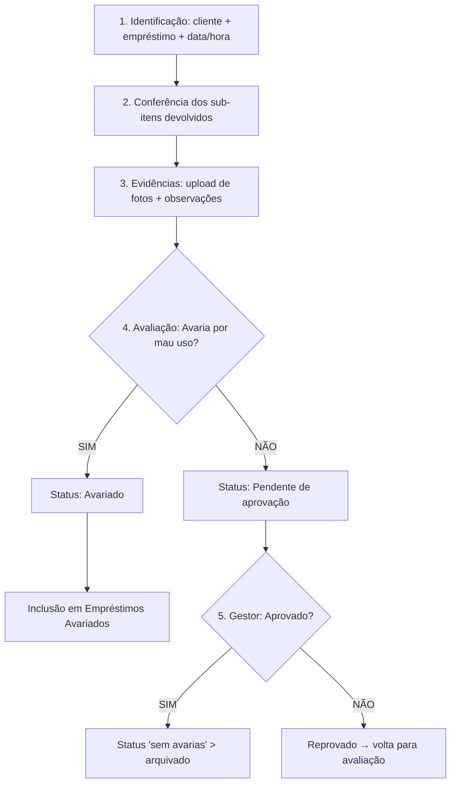

# On.loc — Documentação de Implementação (Frontend)

> Projeto Integrador — Criptografia, Banco de Dados e Desenvolvimento Seguro
> Sistema de **vistoria de equipamentos** da On.loc (empréstimo de equipamentos com número de patrimônio).
> Este documento detalha **o que foi implementado em cada fase** (Fase 0 → Fase 7).

---

## 1. Visão geral

Aplicação **Angular 20 (standalone components + signals)** que cobre o fluxo completo de vistoria:

1. **Autenticação** segura (Analista / Gestor) com sessão JWT de 1 hora.
2. **Cadastro de clientes** (responsável, CPF/CNPJ, nome fantasia, localização).
3. **Gestão de equipamentos** (patrimônio, número de série, sub-itens, status).
4. **Registro de empréstimos** e consulta.
5. **Registro de devolução/vistoria** (wizard de 4 etapas) com anexo de fotos e avaliação de avarias.
6. **Aprovação do Gestor** e arquivamento.
7. **Empréstimos avariados**, **gestão de usuários** e **painel** com indicadores.

O backend real (C++ / libmicrohttpd / MySQL / MinIO) ainda não existe, então **toda a API é mockada com MSW** e isolada atrás de serviços tipados — a troca para o backend real exige apenas desativar uma flag.

### Stack

| Item | Decisão |
|---|---|
| Framework | Angular 20.3 (standalone, signals, zoneless=false) |
| Linguagem | TypeScript 5.9 |
| UI Kit | PrimeNG 20.4 (tema Aura) + PrimeIcons |
| Idioma | pt-BR (tradução customizada do PrimeNG) |
| HTTP | `HttpClient` + interceptors funcionais |
| Mocks | MSW (Mock Service Worker) v3 |
| Testes unitários | Jest 30 + jest-preset-angular 17 |
| Testes E2E | Playwright (Chromium) |
| Compressão de imagem | `browser-image-compression` |

### Papéis (RBAC)

| Papel | Permissões |
|---|---|
| **Analista** | Registrar devoluções/vistorias, anexar fotos, avaliar avaria, cadastrar clientes/equipamentos, consultar |
| **Gestor** | Tudo do Analista + **aprovar/reprovar** auditorias, **arquivar**, gerenciar **usuários** |

---

## 2. Estrutura de pastas

```
src/app/
├── core/
│   ├── api/            # services tipados (clients, assets, loans, inspections, damages, users)
│   │   └── api-base.ts # API_BASE = '/api'
│   ├── auth/           # AuthService (login, token, expiração de sessão)
│   ├── guards/         # authGuard, roleGuard
│   ├── interceptors/   # jwtInterceptor, errorInterceptor
│   ├── i18n/           # primeng-ptbr.ts (Translation do PrimeNG)
│   ├── models/         # domain.ts (interfaces do domínio)
│   └── mocks/          # data.ts, handlers.ts, browser.ts (MSW)
├── shared/
│   ├── components/     # coming-soon.ts
│   ├── directives/     # cpf-cnpj-mask.directive.ts
│   ├── pipes/          # cpf-cnpj.pipe.ts
│   ├── validators/     # cpf-cnpj.validator.ts
│   └── utils/          # cpf-cnpj.ts, asset-status.ts, loan-status.ts, image-compress.util.ts
├── layout/             # shell (sidebar + topbar)
├── features/
│   ├── auth/           # login
│   ├── dashboard/      # painel com métricas
│   ├── clients/        # lista, formulário, detalhe
│   ├── assets/         # lista, formulário, detalhe
│   ├── loans/          # lista, detalhe
│   ├── inspections/    # wizard + lista de devoluções
│   ├── approvals/      # fila do Gestor
│   ├── damaged-loans/  # avariados
│   ├── users/          # lista + formulário
│   └── errors/         # forbidden (403)
├── app.config.ts
├── app.routes.ts
└── app.ts
```

---

## 3. Fase 0 — Setup do projeto

**Objetivo:** criar o scaffold Angular 20 e configurar todo o ferramental.

- `ng new` com Angular 20.3.38 (standalone, SCSS, sem SSR, sem zoneless).
- Instalação e configuração do **PrimeNG 20.4** (tema Aura via `@primeuix/themes@2`) + `@angular/animations`.
- Tradução pt-BR do PrimeNG em `core/i18n/primeng-ptbr.ts` (o PrimeNG 20 não embute locales).
- **MSW v3**: worker em `public/mockServiceWorker.js` + handlers em `core/mocks/`.
- **Jest** (`jest-preset-angular` 17 + `jest-environment-jsdom`) com `testMatch` restrito a `src/**/*.spec.ts`.
- **Playwright** com config + smoke test e browser Chromium instalado.
- Criação da estrutura `core/shared/layout/features`.

**Decisões importantes desta fase:**
- PrimeNG fixado na v20 (a v22 exige Angular 22).
- `@primeuix/themes` fixado na v2 (v3 exige `@primeuix/styled` 1.x, incompatível com PrimeNG 20).
- Angular 20 não tem `provideAnimationsAsync` → usar `provideAnimations` de `@angular/platform-browser/animations`.
- MSW v3 usa `onUnhandledFrame` (não `onUnhandledRequest`) e `params['id']` (não `params.id`).
- Budget inicial elevado para 600 kB (o tema PrimeNG eleva o bundle inicial a ~530 kB).

---

## 4. Fase 1 — Autenticação e Shell

**Arquivos:** `core/auth/auth.service.ts`, `core/interceptors/jwt.interceptor.ts`, `core/interceptors/error.interceptor.ts`, `core/guards/auth.guard.ts`, `core/guards/role.guard.ts`, `features/auth/login.*`, `layout/shell.*`, `features/dashboard/*`, `features/errors/forbidden.ts`.

**O que foi feito:**
- **`AuthService`**: `login()` → `POST /api/auth/login`, armazena token + usuário em `sessionStorage` (chaves `onloc.token` / `onloc.user`), decodifica o `exp` do JWT e programa a expiração (1 h) com `setTimeout`. Métodos `logout()`, `clearSession()`, `isAuthenticated`, `isGestor`, `hasRole()`.
- **`jwtInterceptor`**: anexa `Authorization: Bearer <token>`.
- **`errorInterceptor`**: `401` → limpa sessão e redireciona para `/login`; `403` → `/403`.
- **Guards**: `authGuard` (redireciona para `/login`) e `roleGuard(...roles)` (factory → `/403`).
- **Tela de login** com PrimeNG (e-mail + senha, validação, estado de erro e loading).
- **Shell** (sidebar com navegação filtrada por papel + topbar com avatar/nome/papel/logout).
- **Rotas** lazy com shell protegido; `/dashboard`, placeholders e `/403`.

**Credenciais de exemplo (mock):**
- Analista: `analista@onloc.com.br` (qualquer senha com ≥ 6 caracteres)
- Gestor: `gestor@onloc.com.br` (qualquer senha com ≥ 6 caracteres)

---

## 5. Fase 2 — Clientes

**Arquivos:** `core/api/clients.service.ts`, `shared/utils/cpf-cnpj.ts`, `shared/pipes/cpf-cnpj.pipe.ts`, `shared/directives/cpf-cnpj-mask.directive.ts`, `shared/validators/cpf-cnpj.validator.ts`, `features/clients/clients.*`, `client-form.*`, `client-detail.*`.

**O que foi feito:**
- **`ClientsService`**: `list(search)`, `get`, `create`, `update`, `delete`, `loans(id)`, `isDocumentTaken()`.
- **Validação de CPF/CNPJ** com dígitos verificadores (`isValidCpf`, `isValidCnpj`, `isValidCpfOrCnpj`).
- **Máscara** `cpfCnpjMask` (formata CPF↔CNPJ conforme o tamanho) e **pipe** `cpfCnpj`.
- **Validator síncrono** `cpfCnpjValidator(documentTypeControlName)` + **validador assíncrono de unicidade** do documento.
- **Lista** com busca (debounce), paginação e exclusão com diálogo de confirmação.
- **Formulário** (criar/editar) com seletor CPF/CNPJ, máscara, validação e toast de sucesso.
- **Detalhe** com dados do cliente + histórico de empréstimos.
- `ConfirmationService` + `MessageService` registrados no root; `ConfirmDialog` + `Toast` renderizados no shell.

**Rotas:** `/clientes`, `/clientes/novo`, `/clientes/:id/editar`, `/clientes/:id`.

---

## 6. Fase 3 — Equipamentos

**Arquivos:** `core/api/assets.service.ts`, `shared/utils/asset-status.ts`, `features/assets/assets.*`, `asset-form.*`, `asset-detail.*`.

**O que foi feito:**
- **`AssetsService`**: `list(status)`, CRUD, `loans(assetId)` (histórico) e `isPatrimonyTaken()`.
- **Lista** com filtro por status (Disponível / Emprestado / Avariado) e paginação.
- **Formulário** com patrimônio (unicidade assíncrona), número de série, descrição, status e **sub-itens dinâmicos** (`FormArray`).
- **Detalhe** com informações, sub-itens e histórico de empréstimos.
- Util `asset-status` (rótulos pt-BR + severidade das tags).

**Rotas:** `/equipamentos`, `/equipamentos/novo`, `/equipamentos/:id/editar`, `/equipamentos/:id`.

---

## 7. Fase 4 — Empréstimos

**Arquivos:** `core/api/loans.service.ts`, `shared/utils/loan-status.ts`, `features/loans/loans.*`, `loan-detail.*`.

**O que foi feito:**
- **`LoansService`**: `list({ status, clientId })`, `get(id)`.
- **Lista** com filtros por status e cliente (nomes resolvidos via `ClientsService`).
- **Detalhe** com informações do empréstimo e itens emprestados (patrimônio + devolvido).

**Rotas:** `/emprestimos`, `/emprestimos/:id`.

---

## 8. Fase 5 — Wizard de Devolução (fluxo central)

**Arquivos:** `core/api/inspections.service.ts`, `core/api/damages.service.ts`, `shared/utils/image-compress.util.ts`, `features/inspections/inspection-wizard.*`, `inspections.*`, `features/approvals/approvals.*`, `features/damaged-loans/damaged-loans.*`.

**Fluxo implementado (fiel ao diagrama):**



**Componentes:**
- **`InspectionWizard`** (4 etapas): Identificação → Conferência → Evidências → Avaliação.
  - Seleção de cliente e empréstimo (via `ClientsService.loans`).
  - Checkbox de itens devolvidos.
  - Upload múltiplo de fotos com **compressão no navegador** (`browser-image-compression`, ≤ 1 MB / 1600 px) e galeria de preview.
  - Decisão de avaria (Sim/Não); se **Sim**, exige item + descrição da avaria.
- **`InspectionsService`**: `list`, `create`, `approve`, `reject`.
- **`DamagesService`**: `list()` (avariados).
- **Lista de devoluções** (`/devolucoes`) com tags de avaliação e aprovação.
- **Aprovações** (`/aprovacoes`, Gestor) com aprovar/reprovar e confirmação.
- **Avariados** (`/avariados`) com descrição e item avariado.

**Lógica do mock** (`POST /api/inspections`):
- `avaria_por_mau_uso` → `approval='aprovado'` + `archived=true`, empréstimo vira `com avarias` e cria registros de `damages`.
- `sem_avaria` → `approval='pendente'`; a aprovação do Gestor seta `aprovado` + `archived` + empréstimo `sem avarias`.

**Simplificação conhecida:** ao reprovar, a vistoria fica "Reprovado" e o analista registra uma nova (o loop de reavaliação automática pode ser um refinamento posterior).

---

## 9. Fase 6 — Usuários

**Arquivos:** `core/api/users.service.ts`, `features/users/users.*`, `user-form.*`. Mock: `DELETE /api/users/:id`.

**O que foi feito:**
- **`UsersService`**: `list`, `create`, `delete`, `isEmailTaken()` + constante `ROLES`.
- **Lista** (nome, e-mail, papel) e **formulário** (nome, e-mail com unicidade assíncrona, papel Analista/Gestor).
- Rotas protegidas por `roleGuard('Gestor')`.

**Rotas:** `/usuarios`, `/usuarios/novo` (ambas Gestor).

---

## 10. Fase 7 — Dashboard

**Arquivo:** `features/dashboard/dashboard.ts` (reescrito).

**O que foi feito:**
- Cards de métricas reais (via `forkJoin` das listas): Clientes, Equipamentos, Empréstimos, Devoluções pendentes, Aprovadas, Avariados.
- Lista das 5 devoluções mais recentes.
- Cards clicáveis que navegam para a tela correspondente.

---

## 11. Endpoints mockados (prefixo `/api`)

| Método | Rota | Descrição |
|---|---|---|
| POST | `/auth/login` | Login (retorna token + usuário) |
| POST | `/auth/logout` | Logout |
| GET/POST | `/clients` | Listar / criar |
| PUT/DELETE | `/clients/:id` | Atualizar / excluir |
| GET | `/clients/:id/loans` | Empréstimos do cliente |
| GET/POST | `/assets` | Listar (filtro `status`) / criar |
| PUT/DELETE | `/assets/:id` | Atualizar / excluir |
| GET | `/loans` | Listar (filtros `status`, `clientId`) |
| GET | `/loans/:id` | Detalhe |
| GET/POST | `/inspections` | Listar / registrar vistoria |
| PATCH | `/inspections/:id/approve` / `/reject` | Aprovar / reprovar (Gestor) |
| GET | `/damages` | Empréstimos avariados |
| POST | `/uploads/presign` | URL pré-assinada (MinIO) |
| GET/POST/DELETE | `/users[/:id]` | Usuários (Gestor) |

---

## 12. Como rodar e testar

```bash
npm install
npm start          # http://localhost:4200

npm test           # Jest (unitários)
npm run test:coverage
npm run e2e        # Playwright (E2E) — requer `npx playwright install chromium`
npm run build      # build de produção (dist/)
```

### Mocks vs backend real

Os mocks estão ativos via `ENABLE_API_MOCKS = true` em `src/main.ts`.
Quando o backend C++ estiver disponível, basta trocar para `false`.

---

## 13. Cobertura de testes

- **Jest (15 testes)**: `App` (render), guards (`authGuard`, `roleGuard`), validação de CPF/CNPJ (dígitos verificadores + máscara), `asset-status`, `loan-status`.
- **Playwright (10 testes E2E)**:
  - Login (sucesso e credenciais inválidas).
  - Cadastro de cliente (CPF/CNPJ + máscara).
  - Cadastro de equipamento com sub-item.
  - Lista de empréstimos.
  - Wizard: devolução **sem avarias**.
  - Wizard: devolução **com avaria** → Avariados.
  - Gestor aprova devolução pendente.
  - Gestor cria usuário.
  - Smoke test.

---

## 14. Decisões técnicas e "gotchas" registradas

- **PrimeNG v20**: `Table` não é standalone → importar `TableModule`. `Checkbox`, `Select`, `Textarea`, `RadioButton`, `Tag`, `ConfirmDialog`, `Toast`, etc. são standalone.
- Select do PrimeNG: opções usam classe `p-select-option` (não `role="option"`); botão de aceitar do ConfirmDialog usa classe `p-confirmdialog-accept-button`.
- `Tag` severity usa `warn` (não `warning`).
- `FormArray` no template strict → `[formGroup]="$any(item)"`.
- `getRawValue()` de `FormArray` tipado retorna elementos possivelmente nulos → fazer cast do raw value.
- E2E: limitar workers (4) e usar helper de seleção com retry para evitar flakiness com o delay do mock (300 ms).

---

## 15. Próximos passos (Fase 8)

1. **Integração com o backend real** — trocar `ENABLE_API_MOCKS = false` e validar os endpoints.
2. **Reavaliação automática após reprovação** (loop do diagrama).
3. **Fluxo de senhas** (tabela de senhas criptografadas, definição/recuperação).
4. **Upload real para o MinIO** (substituir o mock de presign por envio efetivo).
5. **Relatórios/exportação** (se necessário no MVP).
