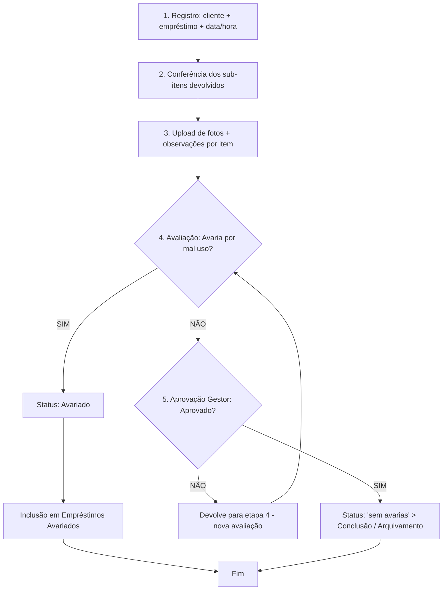

# On.loc — Plano de Desenvolvimento do Frontend

> Projeto Integrador — Criptografia, Banco de Dados e Desenvolvimento Seguro
> Escopo deste documento: **somente o frontend**.

---

## 1. Objetivo

Construir a interface web do sistema de **vistoria de equipamentos** da On.loc, permitindo:

1. Autenticação segura de usuários (`Analista` / `Gestor`) com sessão JWT de 1 hora.
2. Cadastro e gestão de **clientes** (responsável, CPF/CNPJ, nome fantasia, localização).
3. Gestão de **equipamentos** (patrimônio, número de série, sub-itens, status).
4. **Registro de devolução/vistoria** com anexo de fotos e avaliação de avarias.
5. **Aprovação do Gestor** e arquivamento da devolução.
6. Consulta de **empréstimos** e de **empréstimos avariados**.

---

## 2. Stack Técnica

| Item | Decisão |
|---|---|
| Framework | Angular 20+ (standalone components, signals) |
| Linguagem | TypeScript |
| UI Kit | PrimeNG (+ PrimeFlex / CSS próprio) |
| HTTP | `HttpClient` + interceptors funcionais |
| Backend | **Ainda não disponível** → mockado com **MSW (Mock Service Worker)** |
| Idioma da UI | Português (pt-BR) |
| Testes unitários | Jest (`jest-preset-angular`) |
| Testes E2E | Playwright |
| Formatação/Lint | ESLint + Prettier |

> A camada de API será isolada atrás de serviços e tipos, de modo que a troca dos
> mocks (MSW) pelo backend real em C++ (`libmicrohttpd`) seja transparente.

---

## 3. Papéis e Permissões (RBAC)

| Papel | Pode |
|---|---|
| **Analista** | Registrar devoluções/vistorias, anexar fotos, avaliar avaria, cadastrar clientes e equipamentos, consultar |
| **Gestor** | Tudo do Analista + **aprovar/reprovar** auditorias, **arquivar** devoluções, gerenciar usuários |

Regras que a UI deve impor:
- Rotas de aprovação/arquivamento e de usuários protegidas por `roleGuard(['Gestor'])`.
- Botões de ação sensíveis ocultos/desabilitados para `Analista`.
- A API é a autoridade final; a UI apenas antecipa o feedback.

---

## 4. Modelo de Dados (interfaces do frontend)

Espelham as tabelas descritas no documento técnico.

```ts
type Role = 'Analista' | 'Gestor';
type LoanStatus = 'sem avarias' | 'com avarias';

interface User { id: string; name: string; email: string; role: Role; }

interface Client {
  id: string;
  responsible: string;      // responsável
  document: string;         // CPF/CNPJ (somente números + máscara)
  documentType: 'CPF' | 'CNPJ';
  tradeName: string;        // nome fantasia
  location: string;         // localização
  createdAt: string;
}

interface Asset {                 // equipamento / patrimônio
  id: string;
  patrimonyNumber: string;        // número de patrimônio (único)
  serialNumber: string;           // número de série
  description: string;
  subItems: SubItem[];            // sub-itens emprestados
  status: 'disponivel' | 'emprestado' | 'avariado';
}

interface SubItem { id: string; name: string; patrimonyNumber: string; }

interface Loan {                  // registro de empréstimo
  id: string;
  clientId: string;
  organization: string;
  date: string;                   // data (dia e horário)
  details?: string;               // detalhes adicionais
  status: LoanStatus;
  items: LoanItem[];
}

interface LoanItem {              // empréstimo realizado
  id: string;
  assetId: string;
  patrimonyNumber: string;
  returned: boolean;
}

interface Damage {                // empréstimo avariado
  id: string;
  loanId: string;
  loanItemId: string;
  description: string;            // avaria localizada
  photos: string[];               // URLs no MinIO
  registeredBy: string;
  registeredAt: string;
}

interface Inspection {            // registro de devolução/vistoria
  id: string;
  clientId: string;
  loanId: string;
  date: string;
  photos: PhotoEvidence[];
  assessment: 'avaria_por_mau_uso' | 'sem_avaria';
  approval: 'pendente' | 'aprovado' | 'reprovado';
  archived: boolean;
}
```

---

## 5. Mapa de Telas e Rotas

| Rota | Tela | Acesso |
|---|---|---|
| `/login` | Login | Público |
| `/dashboard` | Painel (pendências, totais, últimas devoluções) | Ambos |
| `/clientes` | Lista de clientes (busca, filtro, paginação) | Ambos |
| `/clientes/novo` · `/clientes/:id/editar` | Formulário de cliente | Ambos |
| `/clientes/:id` | Detalhe (histórico de empréstimos) | Ambos |
| `/equipamentos` | Lista de equipamentos (filtro por status) | Ambos |
| `/equipamentos/novo` · `/equipamentos/:id/editar` | Formulário de equipamento | Ambos |
| `/equipamentos/:id` | Detalhe (histórico + fotos) | Ambos |
| `/emprestimos` | Registros de empréstimo (filtros) | Ambos |
| `/emprestimos/:id` | Detalhe do empréstimo | Ambos |
| `/devolucoes/nova` | **Wizard de Registro de Devolução** | Analista+ |
| `/devolucoes` | Lista de devoluções/vistorias | Ambos |
| `/aprovacoes` | Fila de aprovação do Gestor | **Gestor** |
| `/avariados` | Empréstimos avariados | Ambos |
| `/usuarios` | Gestão de usuários | **Gestor** |
| `/403` · `/**` | Acesso negado / 404 | Ambos |

**Layout:** shell com sidebar (itens filtrados por papel), topbar com usuário,
contador de sessão JWT e logout.

---

## 6. Fluxo de Registro de Devolução (wizard)



Etapas na UI:
1. **Identificação** — seleciona cliente (autocomplete) e empréstimo vinculado.
2. **Conferência** — checklist dos sub-itens; itens não devolvidos ficam sinalizados.
3. **Evidências** — upload múltiplo por item, com **compressão no cliente** antes do envio.
4. **Avaliação** — decisão binária de avaria; se SIM, exige descrição da avaria localizada.
5. **Aprovação** — etapa do Gestor (pode ser assíncrona, via fila `/aprovacoes`).

Estado do wizard mantido em `signals` + `sessionStorage` (proteção contra refresh).

---

## 7. Estrutura de Pastas

```
src/app/
├── core/
│   ├── auth/                 # AuthService, token storage, session timer
│   ├── interceptors/         # jwt.interceptor, error.interceptor, loading.interceptor
│   ├── guards/               # authGuard, roleGuard, pendingChangesGuard
│   ├── models/               # interfaces de domínio (seção 4)
│   └── api/                  # ClientsApi, AssetsApi, LoansApi, InspectionsApi, UsersApi
├── shared/
│   ├── components/           # page-header, data-table, confirm-dialog, photo-gallery
│   ├── directives/           # mask.directive
│   ├── pipes/                # cpfCnpj.pipe, loanStatus.pipe
│   ├── validators/           # cpfCnpjValidator, uniqueDocumentValidator (async)
│   └── utils/                # image-compress.util, date.util
├── layout/                   # shell, sidebar, topbar
├── features/
│   ├── auth/                 # login
│   ├── dashboard/
│   ├── clients/
│   ├── assets/
│   ├── loans/
│   ├── inspections/          # wizard de devolução
│   ├── approvals/            # fila do gestor
│   ├── damaged-loans/
│   └── users/
├── app.config.ts
└── app.routes.ts
```

---

## 8. Endpoints Previstos (mockados via MSW)

| Método | Rota | Descrição |
|---|---|---|
| POST | `/auth/login` | Autentica, retorna `{ token, user }` |
| POST | `/auth/logout` | Encerra sessão |
| GET | `/clients` | Lista (query: `search`, `page`) |
| POST/PUT/DELETE | `/clients[/:id]` | CRUD |
| GET | `/clients/:id/loans` | Histórico do cliente |
| GET | `/assets` | Lista (query: `status`) |
| POST/PUT/DELETE | `/assets[/:id]` | CRUD |
| GET | `/loans` | Lista (query: `status`, `clientId`, período) |
| GET | `/loans/:id` | Detalhe |
| POST | `/inspections` | Registra devolução/vistoria |
| GET | `/inspections` | Lista |
| PATCH | `/inspections/:id/approve` | Aprovação (Gestor) |
| PATCH | `/inspections/:id/reject` | Reprovação (Gestor) |
| GET | `/damages` | Empréstimos avariados |
| POST | `/uploads/presign` | URL pré-assinada (MinIO) |
| GET/POST | `/users` | Gestão de usuários (Gestor) |

---

## 9. Autenticação e Segurança

- **Login** → armazena JWT (memória + `sessionStorage`), decodifica expiração.
- **`jwtInterceptor`** anexa `Authorization: Bearer <token>`.
- **`errorInterceptor`**: em `401` → logout + redirect `/login`; em `403` → `/403`.
- **`authGuard`** protege rotas; **`roleGuard`** valida papel.
- **Timer de sessão**: aviso ao usuário ~2 min antes dos 60 min e logout automático.
- Nunca persistir senha; formulário com `autocomplete` correto e sem log de credenciais.
- Sanitização de entradas e uso do `DomSanitizer` para URLs de imagem.

---

## 10. Upload de Imagens

1. Validar tipo/tamanho no cliente.
2. **Comprimir no navegador** (`browser-image-compression`, ex. máx. 1–2 MB) — mitiga o risco de esgotamento de disco da VPS citado no documento.
3. Solicitar URL pré-assinada (`POST /uploads/presign`) e enviar direto ao MinIO.
4. Guardar apenas as referências no registro da vistoria.
5. Tratar falha: nunca deixar foto órfã sem aviso claro ao usuário.

---

## 11. Estratégia de Testes

**Jest (unitário)**
- `cpfCnpjValidator` (dígitos verificadores), máscara do `mask.directive`.
- `uniqueDocumentValidator` (async).
- `jwtInterceptor` (anexa token), `errorInterceptor` (401/403), expiração de sessão.
- `roleGuard`, `authGuard`.
- `image-compress.util` e regras de formulários.

**Playwright (E2E)**
- Jornada: login → seleção de cliente → conferência de sub-itens → upload de fotos →
  classificação (com/sem avaria) → aprovação pelo Gestor → arquivamento.
- Acesso negado: Analista tentando abrir `/aprovacoes` → `/403`.
- Expiração de sessão JWT.

---

## 12. Plano de Execução (fases)

- [ ] **Fase 0 — Setup** — scaffold Angular 20 standalone, PrimeNG, MSW, Jest, Playwright, ESLint/Prettier, tema pt-BR, estrutura de pastas.
- [ ] **Fase 1 — Auth + Shell** — login, `AuthService`, interceptors, guards, layout, mocks de auth.
- [ ] **Fase 2 — Clientes** — lista, formulário (máscara + validação CPF/CNPJ), detalhe.
- [ ] **Fase 3 — Equipamentos** — lista com filtro de status, CRUD, sub-itens.
- [ ] **Fase 4 — Empréstimos** — lista com filtros, detalhe.
- [ ] **Fase 5 — Wizard de Devolução** — 5 etapas, upload com compressão, decisão de avaria.
- [ ] **Fase 6 — Aprovações (Gestor)** — fila, aprovar/reprovar, arquivamento.
- [ ] **Fase 7 — Empréstimos avariados** — lista + galeria de evidências.
- [ ] **Fase 8 — Usuários** — CRUD + papéis (Gestor).
- [ ] **Fase 9 — Dashboard e polimento** — indicadores, estados vazios/erro/loading, acessibilidade.
- [ ] **Fase 10 — Testes e integração** — Jest + Playwright, troca de MSW pelo backend real.

---

## 13. Riscos e Mitigações (frontend)

| Risco | Mitigação |
|---|---|
| Upload massivo de fotos estoura o disco da VPS | Compressão no cliente + limites de tamanho/quantidade |
| Fotos órfãs se o commit no BD falhar | Enviar só após validação; tela de reenvio/limpeza |
| Captura por dispositivos móveis diversa | Layout responsivo + validação antecipada em telas pequenas |
| Sessão de 1h interrompe trabalho no wizard | Rascunho em `sessionStorage` + aviso antes de expirar |
| Backend ainda indisponível | Contrato tipado + MSW permitem desenvolvimento e testes paralelos |

---

## 14. Premissas e Questões em Aberto

**Premissas**
- Backend expõe REST/JSON com JWT em `Authorization`.
- MinIO via URLs pré-assinadas.
- UI exclusivamente pt-BR.

**A definir com o time**
1. Formato exato das respostas da API e do payload do JWT (claims).
2. Usuários são criados apenas por Gestor (sem auto-cadastro)?
3. Reprovação do Gestor reinicia a avaliação do Analista — precisa de histórico/comentário?
4. Regras de unicidade: patrimônio e CPF/CNPJ únicos globalmente?
5. Necessário relatórios/exportação (CSV/PDF) no MVP?
6. Identidade visual da On.loc (logo, cores) para o tema PrimeNG.

---

_Documento gerado como planejamento inicial. Nenhum código foi criado ainda._
